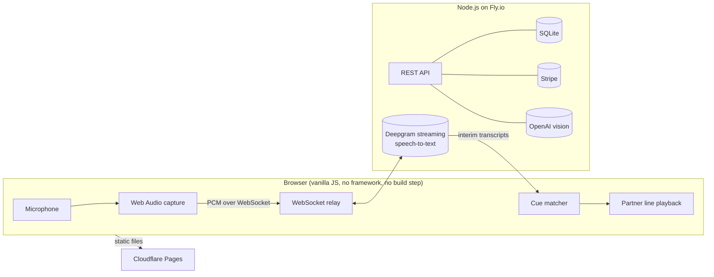

# SelftapePal

**A real-time voice app that acts as a scene partner for actors recording self-tape auditions.**
Live at **[selftapepal.app](https://selftapepal.app)**, with paying subscribers in three currencies. Designed, built
and run by me, end to end.

> The product code is in a private repository because it's a live commercial product. This repo explains how it
> works and the problems I solved building it. I'm happy to walk through the full codebase on request.

---

## What it does

Actors auditioning for TV and film usually record a "self-tape" at home, and they need someone to read the other
character's lines. SelftapePal replaces that person:

1. **Build a scene.** Actor lines, partner lines, sound effects and pauses. Import a script as a PDF, or type it in.
2. **Record the partner lines.** The actor records them in advance, or sends a link so a friend can record them remotely.
3. **Run the scene.** The actor performs. The app listens, recognises the last words of each of their lines (the
   *cue*) as they say them, and plays the next partner line on cue.

Every partner line is a real human recording. There is no synthetic voice anywhere in the product.

## Timeline

| | |
| --- | --- |
| Dec 2025 | First prototype: speech recognition in the browser, listening for a cue word |
| Jan–Feb 2026 | Cue engine, recording, autocue and script import built; I used it for my own real auditions |
| Feb 2026 | Deployed online and shared with actor testers |
| Mar–Jul 2026 | Collaboration with friends, onboarding, payments, accounts, security hardening, analytics |
| Aug 2026 | Public launch after about 480 hours of building; first paying customer five days later |
| Oct 2026 | Native iOS version in progress |

It was also my capstone project for a Higher Diploma in Computing (first class honours).

## Architecture

| Layer | What it uses |
| --- | --- |
| Front end | Vanilla JavaScript, HTML and CSS: no framework, no build step. Cloudflare Pages, enforcing Content Security Policy |
| Server | Node.js on Fly.io, placed in San Jose after latency testing to sit beside the speech provider |
| Data | SQLite: share and trial tokens, usage limits, accounts and analytics |
| Speech | Deepgram Nova-3: streaming for live cue detection, batch transcription for recorded lines |
| Script import | A PDF parser that reads page layout, with an OpenAI vision fallback for scanned scripts |
| Payments and auth | Stripe subscriptions (EUR, GBP, USD) with webhook and billing portal; passwordless email login with JWTs |
| Native iOS (in progress) | Capacitor app with a Swift native audio plugin |
| Testing | Unit tests for cue detection, plus an automated end-to-end check: headless Chrome with a simulated microphone runs the sample scene and records a take against the live API before every release |

## Problems worth talking about

### 1. A cue engine fast enough to feel like a person
The product is judged on one moment: the gap between the actor finishing a line and the partner answering.
- I started with the browser's own speech recognition, then moved to Deepgram streaming. Matching against
  **interim** results instead of final ones made responses noticeably tighter.
- Real dialogue breaks naive matching. The engine handles:
  - cue phrases repeated within a line ("Give me the gun. Give me the gun.");
  - words that sound alike, with US and UK spellings;
  - the curly apostrophes that scripts pasted from Apple Notes carry.
- **The mic hears the speaker too.** If a partner line ends with the same words as the actor's next cue, the
  playback itself could trigger the cue. Short lines get the stream started early, during the partner line, to save
  time, so I added a guard that skips the early start when the words collide.
- The streaming connection opens only while the app is listening, so it never streams (or pays for) idle audio.
  Cue-to-audio latency is logged on every line, and that data decided the server's location.
- When the connection logic regressed, I went back through git history to the last version that behaved well,
  established why, and rebuilt from there.
- I tested it the hard way: as a working actor, I used it for my own real auditions while building it.

### 2. Reading real scripts
Actors receive scripts as PDFs in many formats, and getting them into the app quickly matters more than any
other step.
- The parser reads each word's **position on the page**, which is how screenplay format encodes who is speaking.
- It removes text that's struck through (using the PDF's own annotations) or hidden under white redaction boxes,
  as well as headers and page numbers. It also carries dialogue across page breaks.
- Theatre scripts use a different convention, so a second parser detects it from patterns that recur across the
  page, and only takes over when it's confident.
- I built a debugging tool to run 30 real scripts at once and compare output, instead of checking one at a time.
- Scanned, image-only PDFs fall back to an AI vision model. I designed that path around cost per import, and
  told users plainly that their scripts are never used for training.

### 3. Running a paid real-time service safely
Every minute of listening costs money, so the server holds everything the browser can't be trusted with.
- **Accounts and payments:** passwordless email login with JWTs; Stripe checkout, webhook and billing portal, with
  guards against duplicate subscriptions and replayed checkout sessions.
- **Abuse and cost controls:** daily listening limits per user, caps on simultaneous streams, a whitelist of
  speech models, global circuit breakers, and a heartbeat that clears out dead connections.
- **Hardening:** CORS limited to my own sites; a Content Security Policy moved from report-only to enforcing once the
  reports showed it was safe; integrity hashes on third-party scripts.
- **Privacy:** no raw IP addresses stored, 30-day data retention, and an anonymous analytics design.

### 4. Collaboration without storing anyone's scenes
Actors need a friend to record the partner lines. Storing scenes on the server would have meant ongoing storage
costs and holding people's scripts and voices. So a scene travels as a file with a link, and the server issues a
share token with its own usage limits. The file format went from a custom extension to JSON to a zip, because
messaging apps kept previewing or renaming the files. A return link brings the friend's recordings back into the
actor's scene.

### 5. Recording quality across devices
- Recording moved from MediaRecorder to Web Audio to an AudioWorklet as I chased quality.
- To find the cause of volume dips, I tested noise suppression, automatic gain and echo cancellation one at a
  time. Android now gets its own recording mode.
- Recorded lines are trimmed using word timestamps from transcription. Real takes showed that a fixed cut clipped
  drawn-out words, so the trim keeps audio that's still sounding past the last word.
- **The latest chapter:** Apple's iOS 27 update made web audio crackle with the mic open. I isolated it on a bare
  test page and filed it as **WebKit bug 326286**, which Apple has since taken into its internal tracker. I warned
  affected users the same day, then proved the fix in a native build with a Swift audio plugin.

## Evidence over assumptions
I built my own analytics pipeline:
- an event store in SQLite;
- permanent summary tables;
- an offline queue for events, so none are lost when a device drops its connection;
- funnels by device and user type.

Analytics writes are kept off the cue path.

The data changed decisions. Visitors were reaching the pricing page without ever hearing the app work, so I added
a "Play a scene first" button there, and three of the first four people who pressed it subscribed in the same visit.
It also caught my own mistakes: browsers reporting Windows 11 as "Windows 19", iPads identifying as Macs, and
link-preview bots that looked like a surge of visitors.

## How I work
I build AI-first. AI coding tools produce drafts and implementation, and I set the direction, review the output,
and test it on real devices, with real scripts and against real usage data. Decisions and investigations are
written down as I go.

---

**Donal Gallery** · Dublin · [selftapepal.app](https://selftapepal.app) · [LinkedIn](https://linkedin.com/in/donalgallery)
